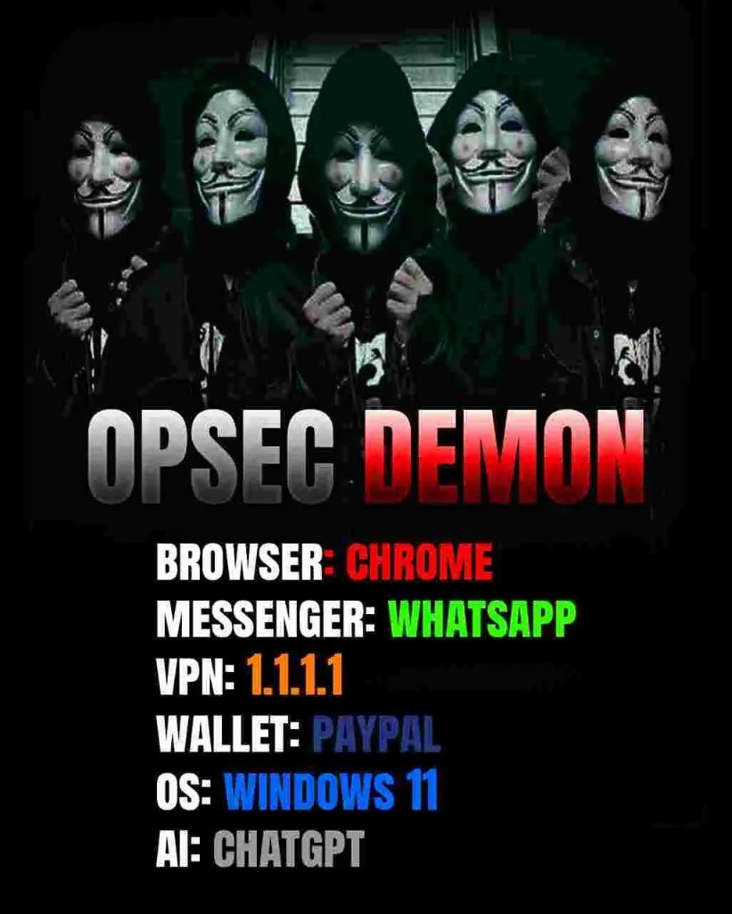

# 🕶️ Hey, I'm Loc (hthienloc)

<table>
  <tr>
    <td width="55%" valign="top">

### 🛡️ Threat Model: "I have no idea what I'm doing"

- 🧠 **Technical Skills:** Copy from StackOverflow, paste into ChatGPT, pray to `git push -f`
- 🌐 **Cybersecurity:** Chrome + Incognito mode = *basically in the matrix*
- 🔐 **Password Manager:** `password123` (with a capital P if required)
- 📡 **Networking:** 1.1.1.1 is totally a VPN, trust me bro
- 🐧 **Linux Guru:** Ran `sudo rm -rf /` once, learned my lesson
- 🤖 **AI Workflow:** AI writes the bugs, I take the credit

---

### 📉 Daily Routine
- 90% Reading error logs with zero comprehension
- 9% Centering a `
` (failed)
- 1% Actually committing working code

---

> *"It works on my machine, and by machine I mean ChatGPT's hallucinations."*

    </td>
    <td width="45%" align="center" valign="middle">
      
       
      <i>Me and the boys after turning on private browsing</i>
    </td>
  </tr>
</table>
